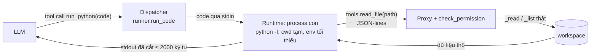

# Phân tích: Challenge B, Context management

Môn SE373, buổi 7 (Memory, Context Engineering & Prompt Caching). Mục tiêu của đề: **giữ context nhỏ gọn mà agent vẫn làm đúng việc**.
Số liệu đầy đủ: [`measurements.md`](measurements.md). Câu trả lời nguyên văn: [`transcripts.md`](transcripts.md).

## 1. Tóm tắt kết quả

| Bài | Tiêu chí của đề | Kết quả | Bằng chứng |
|---|---|---|---|
| B1 | Session dài được compact | 4 lần compact trong 5 lượt; history giảm từ ~15–30k xuống ~1–2k token (ước lượng) | `traces/b1_compaction__turn02.jsonl` seq 10, `__turn03` seq 2, `__turn05` seq 16 và 21 |
| B1 | Agent vẫn nhớ lỗi đang điều tra, cách đã thử, bước tiếp | Lượt 4 trả lời đúng cả 4 ý chỉ từ checkpoint; lượt 5 làm tiếp đúng hướng, số liệu cuối khớp đáp án | `transcripts.md` mục B1 có compaction, lượt 4–5 |
| B2 | Agent trả lời câu hỏi trên nhiều file log | 10 file, 1.575 dòng; top 3 mã lỗi và top 3 endpoint 500 đúng đáp án | `traces/b2_codemode__turn01.jsonl` seq 12–13 |
| B2 | Raw log không đi vào context | Runtime nhận 184.978 byte log mỗi lần quét; context chỉ nhận 852 ký tự stdout. Input 18.073 so với 110.910 token (6,1×), context lớn nhất 5.182 so với 70.747 (13,7×) | `runs/b2_*.json`, field `runtime_bytes`, `stdout` |

## 2. Agent dùng lại và phần thêm mới

Agent nền là `stage-02-skills` của lab Buổi 4 (bản trong `Buoi 4/working`, đã có `list_files`). Mình chọn bản này vì stage-04 dùng tool `bash` gọi `os.killpg` nên không chạy trên Windows.

| File | Thay đổi |
|---|---|
| `compaction.py` | Mới. `Checkpoint` (schema), `selective_prepass`, `find_split`, `CompactionMiddleware`, `parse_checkpoint`, archive |
| `code_runtime/runner.py` | Mới. Dispatcher, proxy `tools.*`, `check_permission`, `Limits`, `run_code` |
| `code_runtime/bootstrap.py` | Mới. Runtime chạy trong process con: SDK `tools`, audit hook, lỗi ngắn |
| `tools/code_mode.py` | Mới. Tool `run_python`, description chứa tài liệu SDK |
| `scripts/gen_logs.py`, `fixtures/data/logs/`, `fixtures/data/src/` | Mới. Log tất định + `expected_summary()` làm đáp án |
| `agent.py` | `active_tools()` (hybrid, bật/tắt `run_python`), thứ tự middleware: limits → Compaction → Observer |
| `config.py` | Cờ `CODE_MODE`, `COMPACTION`, `COMPACT_TRIGGER_TOKENS`; giới hạn runtime; tham số TRUNCATE |
| `app.py` | Áp update bằng `add_messages` (để `RemoveMessage` có hiệu lực), panel Compaction, hiển thị code của `run_python` |
| `observer.py` | Event `compaction`, `compaction_failed`; counter "Compaction trong conversation" |
| `prompts.py` | Hướng dẫn dùng checkpoint, khi nào dùng `run_python` và khi nào dùng `read_file` |

Test offline: 86 passed, 1 skipped (`pytest-stage-05-context.txt`). Test bị skip là test symlink file: Windows không tạo được symlink nếu không có quyền.

## 3. B2: Code Mode

### Code chạy ở đâu (gợi ý slide 33)



- **Runtime:** process Python con (`sys.executable -I -X utf8 bootstrap.py`). Cwd là thư mục tạm trống, env chỉ có `PATH`/`SYSTEMROOT` (không có `OPENAI_API_KEY`, đã có test).
- **SDK:** `tools.list_files`, `tools.read_file` không nằm trong tham số `tools` của API. Chúng được mô tả trong description của `run_python` (cách "nhúng type definitions"; SDK chỉ có 2 hàm nên cách này rẻ hơn progressive disclosure).
- **Proxy:** mỗi lời gọi `tools.*` là một request JSON-lines về harness. Harness kiểm tra quyền rồi gọi đúng hàm `_read/_list` mà tool native dùng, nên các guard path traversal của Buổi 4 được dùng lại, không viết lại.
- **Vào context:** chỉ `stdout` (cắt ở 2.000 ký tự, kèm ghi chú tổng số ký tự), cùng số liệu `proxy_calls`, `runtime_bytes`, `denied`.
- **Hybrid:** khi bật Code Mode vẫn giữ `read_file`. Prompt hướng dẫn model dùng `read_file` khi cần đọc hiểu một file, và dùng `run_python` khi cần quét, đếm, lọc trên nhiều file.

### Model đã dùng Code Mode thế nào (trace `b2_codemode__turn01.jsonl`)

1. `run_python` #1 (seq 8): đọc 1 file, in 6 dòng mẫu để biết định dạng (951 ký tự vào context).
2. `run_python` #2 (seq 12): quét 10 file, đếm bằng `Counter`, in kèm **số liệu kiểm chứng**: số file, tổng dòng, dòng parse lỗi, số theo level, số ERROR theo từng file (852 ký tự).
3. `run_python` #3 (seq 16): chạy lại toàn bộ để đối chiếu tổng (313 dòng ERROR, 172 dòng 500) và xem cặp mã lỗi–endpoint.

Bẫy "lọc sai mà không biết" (explainer, mục 6) được giảm nhờ hai điều. Description của tool yêu cầu in số liệu kiểm chứng, và model đã tự làm thêm: kiểm tra mẫu trước, đối chiếu tổng sau. Đổi lại, cách này tốn thêm 2 lượt LLM so với mức tối thiểu.

### Bẫy và an toàn

| Rủi ro (explainer R11 mục 6) | Xử lý | Test |
|---|---|---|
| Bloat quay lại (code in nguyên file) | Output cap 2.000 ký tự + ghi chú "đã cắt, tổng N ký tự" | `test_output_cap_truncates_and_reports_total` |
| Vòng lặp vô hạn | Timeout 10 s, `proc.kill()` (chạy được trên Windows) | `test_timeout_kills_infinite_loop` |
| Quá nhiều lời gọi tool | Tối đa 300 lời gọi `tools.*` mỗi lần chạy | `test_tool_call_limit` |
| Prompt injection → đọc secret, gửi ra ngoài | Allowlist chỉ 2 tool read-only, không có `http_post`/`write_file`; chặn path ẩn, path ngoài workspace | `test_proxy_enforces_permissions` |
| Đi vòng qua proxy | Audit hook chặn `open`/`listdir` ngoài thư mục Python, ghi file, `socket`, `subprocess` | `test_runtime_blocks_bypassing_the_proxy` |
| Lỗi code | Lỗi ngắn `NameError: … (line 2)`, không trả stack trace | `test_errors_are_short_with_line_number` |

**Không phải sandbox** (slide 31): audit hook có thể bị vượt qua (ctypes, lỗ hổng interpreter), và process vẫn chạy bằng quyền của user. Production cần container hoặc isolate không có mạng và file system, cùng giới hạn CPU/RAM.

### Native đếm trên context dài: đúng lần này, nhưng không đáng tin

Ở B2, native trả lời đúng nhưng phải "đếm thủ công" với 8.941 output token, và chính model ghi chú rằng nên đối chiếu lại bằng script. Ở lần chạy B1 đầu tiên (`b1_v1_toolchoice_failed`, lượt 3 và 5), cùng kiểu đếm trên context dài thì sai:
- `ERR_DB_TIMEOUT` của 3 ngày được báo là 5 / 6 / 14, sau đó "đính chính" thành 16 / 12 / 14. Số đúng là **16 / 4 / 14** (kiểm bằng `grep`).
- Model còn khẳng định có "dòng log trùng khít timestamp và req" giữa hai ngày. Đã kiểm: **không có dòng trùng nào**, đây là ảo giác.

Code Mode đếm bằng code tất định, nên không gặp hai lỗi này.

## 4. B1: Compaction

### Khi nào kích hoạt (gợi ý slide 33, slide 25)

`CompactionMiddleware.before_model` chạy **trước mỗi model call**, kể cả giữa một lượt khi tool output vừa dồn vào. Điều kiện kích hoạt là ước lượng token của message history ≥ `COMPACT_TRIGGER_TOKENS` (12.000). Ngưỡng này là budget riêng, thấp hơn nhiều so với context window, theo nguyên tắc "không đợi context đầy hẳn rồi mới compact". Hai trường hợp không compact:
- Phần cũ chỉ còn checkpoint, tức không có gì mới để tóm tắt.
- Checkpoint không hợp lệ.

### Giữ gì, bỏ gì (slide 23)

1. **Điểm cắt** (`find_split`): giữ nguyên câu hỏi hiện tại của user và **vòng tool call mới nhất** (model chưa xem kết quả). Không bao giờ tách cặp tool_call / tool_result.
2. **Pre-pass tất định** trên phần cũ, trước khi gửi cho summarizer:
   - KEEP: message của user (ràng buộc, quyết định), checkpoint cũ, câu trả lời của assistant.
   - TRUNCATE: tool output dài hơn 1.500 ký tự chỉ còn tối đa 12 dòng khớp `ERROR|WARN|FAIL|ERR_*`, kèm ghi chú số dòng và ký tự gốc.
   - DROP: tool call trùng tool + args, chỉ giữ lần cuối.
3. **Checkpoint có cấu trúc** (slide 22): `goal, current_state, constraints, decisions, findings, failed_attempts, unresolved_errors, files, next_action`. Summarizer được dặn rõ KEEP/TRUNCATE/DROP và "không suy đoán". Nếu đã có checkpoint cũ thì cập nhật nó (incremental).
4. **Thay history:** `RemoveMessage(REMOVE_ALL)` + `[CHECKPOINT #n]` + phần giữ nguyên. System prompt không đổi (static prefix, slide 40). Phần bị bỏ được archive ra `traces/archive/` (slide 19), bản copy nằm ở `traces/b1_compaction__compactNN_archive.jsonl`.
5. **Fallback:** nếu summarizer lỗi, không ra JSON, hoặc thiếu `goal`/`next_action`, thì **không compact** và phát event `compaction_failed`. Giữ history đầy đủ an toàn hơn thay nó bằng một checkpoint hỏng.

### Kiểm chứng

Trích checkpoint #2 (`b1_compaction__turn03.jsonl` seq 2), là checkpoint duy nhất có trong context khi user hỏi ở lượt 4:

```yaml
constraints:
- Bắt buộc giữ API backward compatible vì client mobile v1 phụ thuộc response hiện tại.
- Không đổi shape/field của response thành công và không đổi cách hiểu status code với mobile v1.
failed_attempts:
- Team đã tăng token TTL từ 900s lên 1800s ngày 15/10 nhưng không giúp; số liệu 10-15 và 10-16 xác nhận lỗi vẫn 6 lần/ngày, không giảm so với 8 lần ngày 10-14.
unresolved_errors:
- ERR_TOKEN_REFRESH_RACE tại /api/auth/refresh vẫn chưa được fix; request thứ hai trả status=500 detail=refresh_token_already_rotated ...
next_action: ... đọc nốt 10-11…10-13 và 10-17…10-20 để kiểm tra xu hướng ..., rồi chốt và triển khai fix idempotent/grace window hoặc lock per-session mà không đổi schema hay status code hiện tại.
```

- **Lượt 4** (input 11.222 token, không còn raw log nào): agent nêu đúng lỗi, cơ chế race, ràng buộc backward compatible, cách đã thử (TTL 900s → 1800s) cùng bảng số liệu chứng minh không hiệu quả, và bước tiếp theo.
- **Lượt 5** ("Làm bước tiếp theo đó đi"): agent làm đúng `next_action`, tức đọc 6 log còn lại, không lặp lại hướng TTL, ghi báo cáo vào `output/`. Bảng cuối 5, 7, 9, 8, 6, 6, 6, 4, 10, 13 **khớp chính xác** ground truth.

### Điều quan sát được (rủi ro thật, không phải lý thuyết)

1. **Compaction phá cache prefix (slide 43).** Ở lượt 1–4, tổng input giảm 35%, nhưng input không cache **tăng 21%** (47.711 so với 39.517). Sau mỗi lần compact, `cache_read` tụt về khoảng 1.280 token (chỉ còn phần system prompt). Cộng thêm chi phí summarizer (8.223 in / 3.859 out), chi phí minh họa khi cache còn ấm là $0,466 có compact so với $0,418 không compact. Khi cache đã nguội thì ngược lại: $0,563 so với $0,716. Nên compact hay không là một quyết định chi phí, đúng như Phần III và Challenge C.
2. **Ở quy mô ~27k token, không compact model vẫn nhớ đúng.** Run không compaction trả lời lượt 4 cũng đúng. Ở quy mô này, giá trị của compaction là giới hạn tốc độ context tăng (context lượt 4 nhỏ hơn 58%), chưa phải "cứu" trí nhớ. Lợi ích về chất lượng chỉ xuất hiện khi context tiến gần giới hạn, và bài lab chưa đẩy tới mức đó.
3. **TRUNCATE có thể làm mất bằng chứng (slide 21).** Checkpoint #4 được tạo khi 6 tool output đều đã bị TRUNCATE. Summarizer tự ghi rằng số liệu chỉ là "lower bound", nên agent phải `read_file` lại 1 file. Checkpoint trung thực nhưng tốn thêm một lần đọc. Hướng cải thiện: để model chốt kết luận trước khi compact, hoặc archive kèm đường dẫn để agent đọc lại đúng chỗ.
4. **Summarizer có thể làm lệch mục tiêu và bỏ sót.** Ở checkpoint #2, `goal` bị thu hẹp thành yêu cầu gần nhất ("xác nhận bằng số liệu từ log 15/10"). Số liệu ngày 11/10 (5 lần) của lượt 1 không còn trong `findings`. Checkpoint cũng ghi "3/11 file" trong khi thực tế có 10 file. Agent vẫn làm đúng việc, nhưng đây là ví dụ thật của rủi ro "hallucinate, bỏ sót". Có thể giảm bằng cách giữ nguyên văn message đầu tiên của user.
5. **Vòng tool chưa xem thì không compact được.** Compact #1 và #3 giảm ít (~34,6k → ~28,9k) vì 6 log vừa đọc buộc phải giữ nguyên, và call kế tiếp vẫn mang 44.351 token. Compaction không chặn được một vòng tool đơn lẻ quá lớn; việc đó là của Code Mode hoặc tool-output pruning.
6. **Provider từ chối `tool_choice`.** Phiên bản đầu dùng structured output qua function calling; DeepSeek ở thinking mode trả lỗi 400. Fallback đã chạy đúng: 3 lần `compaction_failed`, history giữ nguyên, agent vẫn trả lời. Bản hiện tại đưa JSON Schema vào prompt và validate bằng Pydantic, nên chạy được với mọi provider.

## 5. Compaction và Code Mode (slide 34) với số liệu thật

| Tiêu chí | Compaction (B1) | Code Mode (B2) |
|---|---|---|
| Thời điểm | Sau khi dữ liệu tích lũy (trước model call, khi vượt ngưỡng) | Ngay khi chạy tool |
| Tác động đo được | Context lượt 4: 26.446 → 11.222 (−58%) | Context lớn nhất: 70.747 → 5.182 (−93%) |
| Chi phí phụ | Summarizer call; mất cache prefix | Thêm lượt LLM để viết và chạy lại code |
| Rủi ro đã thấy | Checkpoint lệch mục tiêu, TRUNCATE mất bằng chứng | Lọc sai mà không biết (giảm bằng số liệu kiểm chứng); runtime không phải sandbox |
| Không làm được | Không thu nhỏ được vòng tool vừa trả về | Không giúp khi model cần đọc hiểu nội dung |

Hai kỹ thuật bổ sung cho nhau. Code Mode giảm tốc độ context tăng, nên ít phải compact hơn, tức ít lần mất cache prefix và ít lần có nguy cơ mất thông tin khi tóm tắt. Compaction xử lý phần history vẫn tích lũy qua nhiều lượt. Agent của repo cho phép bật cả hai (mặc định đều bật).

## 6. Trả lời các gợi ý của slide 33

- **B1, tạo session dài có log lớn để thử:** 10 file log khoảng 18 KB mỗi file, sinh tất định; session 5 lượt với `CODE_MODE=0` để raw log vào context.
- **B1, khi nào kích hoạt compact:** trước mỗi model call, khi ước lượng token history ≥ 12.000 (cấu hình được). Kích hoạt cả giữa lượt; không đợi đầy context window.
- **B1, giữ gì, bỏ gì:** KEEP user/ràng buộc/quyết định/lỗi chưa giải quyết/cách đã thử/bước tiếp (trong checkpoint) cùng vòng tool mới nhất; TRUNCATE tool output cũ còn các dòng lỗi chính; DROP tool call trùng; raw được archive.
- **B2, có tool chạy lệnh thì code chạy ở đâu:** trong process Python con của harness, cwd tạm, env tối thiểu; dữ liệu chỉ đi qua proxy `tools.*`.
- **B2, script chỉ in kết quả cuối:** description của tool bắt buộc điều này, harness áp output cap. Trong thực tế 3 lần chạy chỉ in 951 / 852 / 572 ký tự.
- **B2, đo input tokens qua usage:** `run_case.py` lấy `usage_metadata` của từng call từ snapshot của observer. Kết quả 110.910 so với 18.073 input token.

## 7. Vị trí bằng chứng

| Nội dung | File |
|---|---|
| Trace B2 native / Code Mode | `traces/b2_native__turn01.jsonl`, `traces/b2_codemode__turn01.jsonl` |
| Trace B1 có / không compaction | `traces/b1_compaction__turn01..05.jsonl`, `traces/b1_no_compaction__turn01..05.jsonl` |
| Raw history bị compact (archive) | `traces/b1_compaction__compact01..04_archive.jsonl` |
| Lần chạy fallback (`tool_choice` bị từ chối) | `traces/b1_v1_toolchoice_failed__turn01..05.jsonl` |
| Usage theo từng call, checkpoint đầy đủ | `runs/*.json` |
| Lượt chat của B1 | `b1_turns.txt` |
| Test | `pytest-stage-05-context.txt` |
